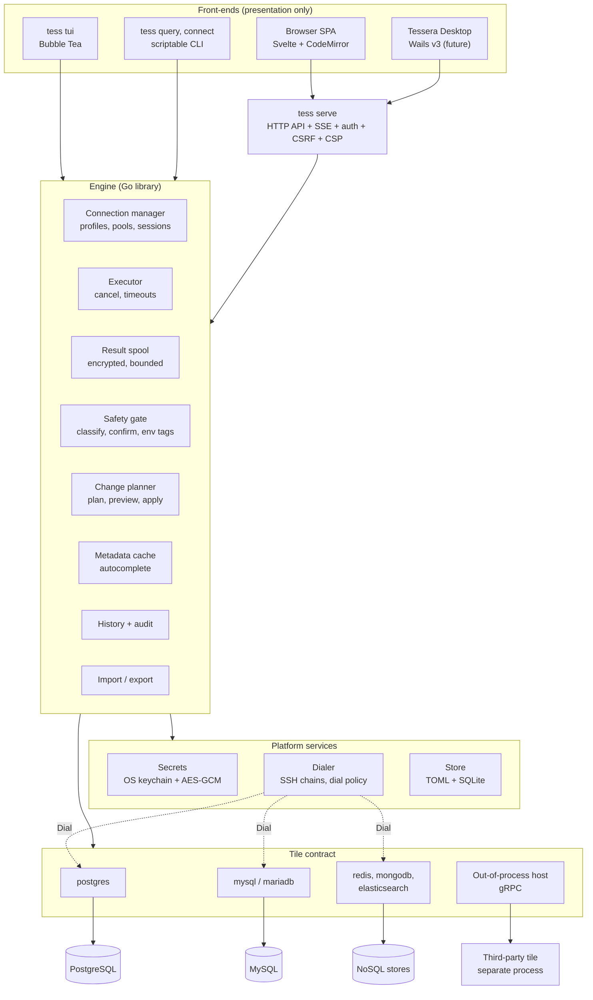
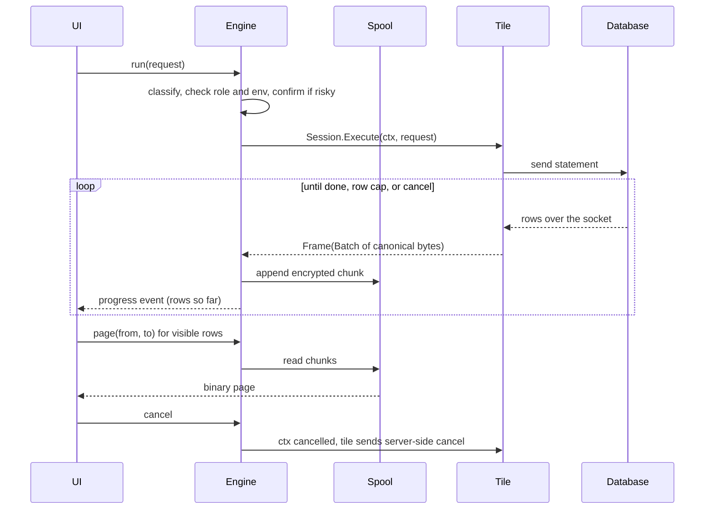
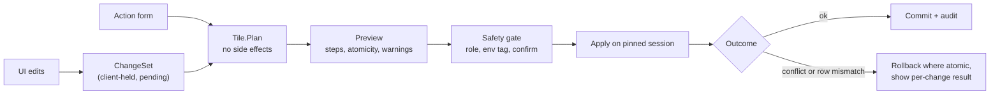

# Tessera: Architecture and Design

Status: in implementation since November 2026. Progress is in [task.md](task.md), and measurements are in [spike-results.md](spike-results.md).
The plugin contract is [tile/tile.go](../tile/tile.go). It holds only what is built so far, so facets this document describes that are not yet in the code arrive as they are implemented.

## Decisions at a glance

| Question | Decision |
|---|---|
| Plugin mechanism | Hybrid. First-party tiles compile in. Third-party tiles run out of process over gRPC, added only after the NoSQL tiles have proven the contract. |
| Frontend | Svelte 5 with SvelteKit in static SPA mode. HTMX is rejected for this product. |
| Editor | CodeMirror 6 |
| Grid | Custom DOM-virtualized grid. No canvas, because of accessibility. |
| Web transport | Plain HTTP pages plus SSE. No WebSocket, no extra dependency, and it fits Wails. |
| Autocomplete | Hand-written tolerant lexer and clause tracker. Neither Vitess nor `pg_query` is used. |
| Build | `CGO_ENABLED=0` for `tess`. Only the desktop app accepts cgo. |
| Local state | TOML for config and profiles, SQLite (`modernc.org/sqlite`) for history, saved queries, cache, and audit. |
| Secrets | A random master key in the OS keychain, encrypting secret blobs with AES-256-GCM. Argon2id passphrase as fallback. |
| Cloud auth | A configurable token helper command. No cloud SDKs. |

## Requirements that conflict or are unrealistic

These are the places where the brief cannot be met as written, with the proposed resolution.

1. **"Every connection mode" in v1 is not achievable.** `go-sql-driver/mysql` documents no GSSAPI or Kerberos support. Windows SSPI and PostgreSQL OAuth need extra work. Section 6 marks each mode v1 or later.
2. **"Never load full results" conflicts with a scrollable 1M-row grid.** A forward-only stream has no random access. Resolution: table browsing uses keyset queries, and console results go to a bounded spool on disk (section 9).
3. **The spool conflicts with "protect data at rest".** Query results would sit in temp files. Resolution: encrypt each spool with an in-memory key that dies with the result, cap its size, and delete it on close.
4. **Backpressure conflicts with server health.** A paused reader holds a PostgreSQL snapshot open, which blocks vacuum cleanup. MySQL drops a client that stops reading for `net_write_timeout` (60 seconds by default). So the engine must not simply stop reading. It drains into the spool until the cap, then cancels and reports "truncated at N rows".
5. **"Read-only connections" is a guardrail, not a security boundary.** A client cannot fully prove a statement is safe: `SELECT my_writing_function()`, `EXPLAIN ANALYZE DELETE`, and MySQL's executable comments `/*!50000 DROP TABLE x */` all defeat naive checks. Resolution: use server-enforced read-only transactions where available, classify statements on a default-deny basis, and tell admins that the only hard guarantee is a read-only database role.
6. **"Per-user, per-connection permissions" cannot extend to tables.** Tessera cannot reliably parse arbitrary text in every language, so permissions stop at the connection level: `viewer` (browse only, no console), `reader`, `editor`, `admin`. Finer control belongs to database roles, and each Tessera role can map to different database credentials.
7. **"Transactional apply" is not possible everywhere.** MySQL DDL commits implicitly. Redis `MULTI` has no rollback. Elasticsearch has no transactions. Resolution: each plan declares its `Atomicity`, and the preview shows it before the user applies.
8. **"No breaking changes for future plugins" cannot be promised before those plugins exist.** Resolution: the contract stays `v0` until the Redis and MongoDB tiles have shipped, and a small Redis tile is built during the MVP to find SQL-centric mistakes early.
9. **Identical shortcuts across web and TUI are impossible.** Browsers reserve `Ctrl+T` and `Ctrl+W`. Many terminals cannot distinguish `Ctrl+Enter`. Resolution: one shared action map with documented fallbacks (section 12).
10. **Visual designers will not reach the TUI.** The TUI gets the same operations through forms and previews. The feature parity is in operations, not in presentation.
11. **"Responsive" stops at tablet width.** A data grid and an editor have no useful phone layout. A phone gets a usable read-only view at most.
12. **Native SQL dumps are a trap.** Re-implementing `pg_dump` correctly is a project in itself. Resolution: Tessera exports data natively (CSV, JSON, `INSERT`, `COPY`), and for full backups it calls the user's own `pg_dump` or `mysqldump`.
13. **Scope.** Phase 1 as written is several person-years. Section 13 cuts the MVP hard so that a usable product ships early.

## 1. Architecture overview

Principles:

- The engine is a Go library. Front-ends call it in process, and only `tess serve` adds HTTP on top.
- Plugins know databases. The engine knows sessions, safety, audit, and streaming. Front-ends know presentation.
- Plugins never receive UI code paths. They describe trees, forms, and results as data, so a new tile works in all front-ends with no front-end change.



Query data flow:



## 2. Core domain model and capability model

Full definitions are in [tile/tile.go](../tile/tile.go). The concepts:

| Concept | Meaning | Why it is not SQL-shaped |
|---|---|---|
| `Tile` | Plugin entry: manifest, connection form, `Open` | The form is data, so connection UI needs no per-database code |
| `Conn` | A logical connection (usually a pool) | Works for a pool, an HTTP client, or a cluster client |
| `Session` | Where statements run; can be pinned to one connection | Holds transactions, temp tables, and `SET` state, and also Redis `SELECT` |
| `ObjectRef`, `Node` | A path of `(Kind, Name)` segments with plugin-defined kinds, always paginated | No fixed database, schema, table hierarchy |
| `Request` | Language ID plus opaque text and bound args | The engine never parses it |
| `ResultStream`, `Frame`, `Shape` | Pull-based frames in a declared shape | Rendered natively, no flattening of documents into rows |
| `Value` | A kind plus canonical bytes | Lossless: `int64`, `numeric`, and `Decimal128` never pass through a float |
| `ChangeSet`, `Plan` | Intended edits, then the exact steps | Section 4 |
| `ActionSpec` | A named operation with a form, a risk level, and an optional designer hint | One mechanism for DDL, users, grants, TTL, and index admin |
| `Language` | Split, classify, complete, diagnose, redact | Works for SQL, Redis commands, and JSON DSLs |

The contract in brief:

```go
type Conn interface {
	Capabilities() Capabilities // evaluated for the connected server version
	Ping(ctx context.Context) error
	Close() error
	Session(ctx context.Context, opt SessionOptions) (Session, error)
	Tree() ObjectTree
	Language(id string) Language
}

// Pull-based: not calling Next is the backpressure.
type ResultStream interface {
	Next(ctx context.Context) (Frame, error)
	Close() error
}

// Canonical bytes, so the common path needs no decode and no re-encode.
type Value struct {
	Kind      ValueKind
	Raw       []byte
	Truncated bool   // Raw is a preview
	FullSize  int64
	Handle    string // fetches the whole value on demand
}
```

Optional features are separate facets (`Browser`, `Editor`, `Actions`, `Explainer`, `Insight`, `BulkIO`), discovered by type assertion and advertised in `Capabilities`. New features become new facets, so existing plugins keep working.

**Capabilities** are namespaced strings (`tx.ddl`, `data.ttl`, `admin.users`). They are evaluated after connecting, because they depend on server version and topology. Each carries a note, so the UI can say why something is unavailable ("needs a replica set") instead of hiding it. Unknown capabilities are ignored, which keeps old hosts and new plugins compatible.

### Mapping to the five reference databases

| Concept | PostgreSQL | MySQL | MongoDB | Redis | Elasticsearch |
|---|---|---|---|---|---|
| Data model | relational | relational | document | key-value | search |
| Tree | database, schema, table/view/function, column/index | schema, table/view/routine, column/index | database, collection, index | db index, key namespace (from `:` prefix), key | cluster, index or alias, mapping/shards |
| Tree paging | `LIMIT` on catalog | `LIMIT` on `information_schema` | `listCollections` cursor | `SCAN` cursor with `MATCH` | `_cat/indices` with pattern |
| Language | `sql-pg` | `sql-mysql` | `mongo-shell` subset, pipeline JSON | `redis` commands | `es-dsl`, `es-sql` |
| Result shape | Tabular | Tabular | Document | KeyValue, Tabular for lists, Scalar | Document, Tree for aggregations |
| `Value.Raw` | PG text format | MySQL text protocol | Extended JSON | RESP bytes | JSON |
| Browse | keyset `WHERE (pk) > (?)` | keyset | `find` with `_id` range | `SCAN`, then type-specific read | `search_after` with PIT |
| Filter AST compiles to | bound SQL | bound SQL | typed BSON query | key pattern, type, TTL filter | `bool` query JSON |
| Identity | primary or unique key | primary or unique key | `_id` | key plus member/field | `_index` plus `_id` |
| Concurrency guard | old values in `WHERE` | old values in `WHERE`, with `clientFoundRows=true` | old values in the filter | `WATCH` | `if_seq_no`, `if_primary_term` |
| Atomicity | transaction (DDL too, with exceptions like `CREATE INDEX CONCURRENTLY`) | transaction for DML; DDL per item | transaction on replica set or sharded, otherwise per item | exec-batch, no rollback | per item (`_bulk`) |
| Cancel | `CancelRequest` | `KILL QUERY` on a second connection | `killOp` / context | closes the connection for blocking ops | `DELETE _tasks/{id}` or closes the request |
| Read-only enforcement | `READ ONLY` transaction | `START TRANSACTION READ ONLY` | client side only | ACL user, otherwise client side | API key privileges, otherwise client side |
| Explain | `EXPLAIN (FORMAT JSON)`, Tree | `EXPLAIN FORMAT=JSON`, Tree | `explain()`, Tree | not supported (`SLOWLOG` as a panel) | `_explain`, `profile`, Tree |
| Distinct `Actions` | DDL, roles, grants, `VACUUM` | DDL, users, grants, `OPTIMIZE` | index, validator, users | `EXPIRE`, `RENAME`, `FLUSHDB`, ACL | create index, mapping, alias, reindex |
| Risky verbs | `DROP`, `TRUNCATE`, unbounded writes | same, plus `/*! */` | `drop`, `deleteMany({})`, `$out`, `$merge` | `FLUSHALL`, `FLUSHDB`, `DEL` on patterns | `DELETE /index`, `_delete_by_query` |
| Key caps | all `tx.*`, `explain.*`, `admin.*` | no `tx.ddl` | `tx.multi` conditional | `data.ttl`, `data.pubsub`; no `struct.*` | `query.fulltext`, `query.aggregate`; no `tx.*` |

The hardest fit is Redis, because a key's edit form depends on its type. `Change.Op` is open-ended (`lpush`, `expire`) and `Designer` hints select a per-type editor. This is why a small Redis tile is part of the MVP.

## 3. Plugin system

| Option | Overhead | Isolation | Verdict |
|---|---|---|---|
| Compile-time registration | None | None | **Use for all first-party tiles.** |
| Out of process over gRPC (`hashicorp/go-plugin` v1.8) | Copy and framing per batch, startup cost per plugin | Crash isolation, separate address space, not a sandbox | **Use for third-party tiles, from Phase 3.** |
| WASM (`wazero` 1.12) | Moderate, and all I/O proxied | Real sandbox | **Reject for drivers.** WASI preview 1 cannot open outbound sockets, so no existing Go driver would work without a host-proxied socket layer. Reconsider for sandboxed helpers such as formatters. |
| Go `plugin` package | None | None | **Reject.** No Windows support, requires an exact toolchain and dependency match, and plugins cannot be unloaded. |

**Why the out-of-process host waits for Phase 3.** It brings in gRPC and protobuf, which is the largest dependency tree in the project, and no third-party tile can exist before the contract is stable. Batching keeps overhead low, since one RPC carries thousands of rows. A release gate requires out-of-process throughput within 15% of in-process, measured with the same benchmark.

**Registration:** first-party tiles use an explicit list in `cmd/tess`, not `init()` side effects, so the set of compiled-in code is visible in one place.

**gRPC contract:** one service per facet, mirroring the Go interfaces. The host wraps them in the same `tile.Tile` interface, so the engine cannot tell the two kinds apart.

```proto
service Tile   { rpc Handshake(HostInfo) returns (Manifest); rpc Open(OpenRequest) returns (OpenReply); }
service Conn   { rpc Capabilities(ConnRef) returns (CapabilitySet); rpc OpenSession(SessionRequest) returns (SessionRef); }
service Exec   { rpc Execute(ExecuteRequest) returns (stream Frame); rpc Cancel(CancelRequest) returns (Empty); }
service Tree   { rpc Children(ChildrenRequest) returns (ChildrenReply); rpc Describe(ObjectRef) returns (ObjectDetail); }
service Editor { rpc Plan(ChangeSet) returns (Plan); rpc Apply(ApplyRequest) returns (ApplyResult); }
// Host-side service the plugin calls back into:
service HostEnv { rpc Dial(stream DialFrame) returns (stream DialFrame); rpc Secret(SecretRequest) returns (SecretReply); }
```

gRPC streams give flow control, so backpressure carries across the process boundary.

**Versioning:**

- `tile.APIVersion` is an integer checked at handshake. A mismatch is refused with a clear message.
- Within a major version, only additions: new facets, capabilities, and optional proto fields.
- Tiles declare features through capabilities, not through version checks.
- A breaking change means `tile/v2` and a host that serves both for at least one year.
- `v0` makes no promises. `v1` is declared after the Redis and MongoDB tiles ship.

**Trust model.** A separate process is not a sandbox: an out-of-process tile runs with the user's OS privileges. Therefore:

- Plugins install only by explicit user action, and show publisher, hash, and requested network targets.
- A plugin is pinned by SHA-256 at install and verified with an Ed25519 signature. Tessera warns on unsigned plugins.
- A plugin receives only the secrets of connections opened through it, and only at open time.
- Network traffic goes through `Env.Dial` by convention only. Without an OS sandbox this cannot be forced.
- `tess serve` refuses third-party plugins unless an admin enables them in the config file.
- Landlock and seccomp on Linux, and AppContainer on Windows, are possible later hardening. They are not assumed here.

## 4. CRUD and admin design

### One pipeline for every change



Rules:

1. **Pending edits are data, not statements.** The grid keeps a `ChangeSet` and marks changed cells. Undo removes a change. Nothing touches the database until apply.
2. **`Plan` has no side effects, and its result is immutable and hashed.** `Apply` takes the plan and the engine verifies the hash, so the text previewed is the text run.
3. **Every update is guarded.** `WHERE pk = ? AND edited_col = ?` (old value). Affected rows must match `ExpectRows`, and a mismatch means a conflict: the whole transaction rolls back and the user sees which row changed. MySQL needs `clientFoundRows=true`, otherwise an update to the same value reports 0 rows and looks like a conflict.
4. **Editability is explicit and explained.** No primary or unique key means read-only, with the reason shown in the UI. No guessing with `LIMIT 1`.
5. **Console results are editable only when the source is proven.** PostgreSQL reports the table and column of each result column, so detection is exact. `go-sql-driver/mysql` does not expose the original table name through `database/sql`, so for MySQL only browse-mode grids are editable in v1, plus simple single-table `SELECT` statements recognized by the lexer and checked against the catalog.
6. **All engine-generated text is parameterized.** Values are bound, and identifiers go through the tile's quoting function. The preview renders bound values as literals for reading only.

### Admin through `Actions`

DDL, users, grants, TTL, index creation, and similar operations are all `ActionSpec`: a form plus a risk level, producing a `Plan`. That gives:

- Web, desktop, and TUI render every admin operation from one form schema.
- Preview, confirmation, and audit come free.
- A new tile gets admin UI without front-end code.

The `Designer` hint selects a richer view where a form is not enough: `relational-table` (column list, indexes, constraints), `json-doc`, `redis-hash`. A designer still produces `Action` input and goes through the same pipeline. Unknown hints fall back to the form.

### Generalizing to NoSQL

| Operation | SQL | MongoDB | Redis | Elasticsearch |
|---|---|---|---|---|
| Inline edit | cell patch, `UPDATE` | JSON-path patch, `$set` / `$unset` | per-type: `HSET`, `LSET`, `ZADD` | partial `_update` |
| Whole record | form view | validated JSON editor | per-type editor | validated JSON editor |
| Insert / delete | `INSERT`, `DELETE` | `insertOne`, `deleteOne` | `SET`, `DEL` | `_doc`, `DELETE` |
| TTL | not applicable | TTL index action | `EXPIRE`, `PERSIST` | ILM action |
| Preview | SQL text | `db.c.updateOne(...)` | command list | `POST _bulk` body |
| Guard | old values | old values in filter | `WATCH` | `if_seq_no` |

## 5. Frontend recommendation

**Verdict: Svelte 5 with SvelteKit in static SPA mode (`adapter-static`, `ssr = false`), embedded with `go:embed`.**

| Criterion | SvelteKit | HTMX + templ |
|---|---|---|
| Virtual grid, inline edits, pending state | Native fit | Needs a large custom JS layer anyway |
| Code editor and autocomplete | Natural | Must be JS regardless |
| Latency | Local interactions need no round trip | Each interaction is a server trip, and a remote `tess serve` feels it |
| Wails v3 reuse | Same bundle; Svelte is a listed v3 template | Would need a local server, losing HTMX's simplicity |
| Runtime size | Compiled, small | HTMX is small, but the custom JS outweighs it |
| npm supply chain | Real cost: a Node toolchain at build time | Almost none |
| Single binary | `embed` static output, no Node at runtime | Native |

HTMX is excellent for server-rendered CRUD pages, but Tessera's main screen is an editor plus a virtual grid. Nearly all the difficulty would be in JavaScript that HTMX does not help with. The npm cost is real and is contained by a short dependency list, a lockfile, and `--ignore-scripts`.

SvelteKit's server features are unused. If its routing brings nothing after M0, dropping to plain Svelte and Vite is a small change, since the app is a single workspace.

**Editor: CodeMirror 6.** It is modular, so only what is used ships. It renders only the viewport, so large documents stay fast. Autocomplete, lint, and language support are separate extensions with custom sources, which fits engine-driven completion. Monaco is rejected: it is much larger, leans on web workers and an AMD-era build, has weak mobile support, and is harder to fit under a strict CSP.

**Grid: custom, DOM-virtualized.**

- **Why not a library:** AG Grid has the community/enterprise split this project exists to avoid, and glide-data-grid is canvas and React.
- **Why not canvas:** canvas is faster, but makes WCAG AA very expensive. A DOM window of about 50 rows by 20 columns is about 1,000 recycled cells, which holds frame rate with careful updates. `role="grid"`, `aria-rowcount`, and `aria-rowindex` give real screen reader support.
- **Virtual scrollbar:** 1M rows at 28px is 28M pixels, beyond the maximum element height of some browsers. Firefox stops honouring `position: sticky` near 8.9M pixels, so scroll height is capped at 8M. Above that the scrollbar is scaled, and the grid owns its position and handles wheel input, because one scrollbar pixel covers several rows.
- **Decoding in a Web Worker,** with a small page cache around the viewport.
- **JSON tree:** the same windowing over a flattened list of visible nodes, with subtrees fetched on expand.

The grid is the highest-risk frontend component, so M0 prototypes it first, with a canvas fallback decision if it misses targets.

**Web transport: HTTP plus SSE.**

- `POST /api/exec` starts a query and returns a result ID.
- `GET /api/results/{id}/pages?from=&to=` returns a binary page from the spool. This is random access, which is what a virtual grid needs, and the client controls its own pull rate.
- `GET /api/events` is one SSE stream per browser tab for progress, query state, and later pub/sub messages.

This uses only `net/http`. Page encoding is a small length-prefixed binary format, written by hand in Go and TypeScript and fuzz-tested. Every number that does not fit in a JS double stays a string. HTTP/1.1 limits a browser to about 6 connections per origin, so several browser tabs can exhaust SSE slots. A `BroadcastChannel` leader tab or HTTP/2 over TLS solves this.

**Wails v3 fit.** Wails v3.0.0 was released as stable on 26 October 2026, with Windows, macOS (Intel and Apple Silicon), and Linux on amd64 and arm64. It uses the platform's native WebView. Plan:

- The frontend talks to a `Transport` TypeScript interface, with an HTTP implementation first.
- Desktop reuses the same `http.Handler` through Wails' asset handler, so there is no local port to protect.
- Events may need Wails' own event bus instead of SSE. This is unverified, so M0 runs a short spike.
- Linux uses WebKitGTK 6 by default, and macOS uses WKWebView. Their rendering and performance differ from Chromium, so the grid must be tested on WebKit from the start, not at desktop time.
- Wails needs cgo on macOS and Linux, so the desktop app has its own Go module, and `tess` stays cgo-free.
- v3.0.0 is days old. The release notes advise pinning exact versions. Desktop is the last phase, so this risk shrinks with time.

## 6. Connection-mode matrix

`v1` = v1.0. `v1.x` = shortly after. `later` = on demand. `n/a` = does not exist. Driver facts come from the `go-sql-driver/mysql` README and `pgconn` docs. Items marked † need a spike to confirm.

### SQL databases

| Mode | PostgreSQL (`pgx`) | MySQL / MariaDB (`go-sql-driver`) |
|---|---|---|
| TCP IPv4/IPv6 | v1 | v1 |
| Unix socket | v1 | v1 |
| Windows named pipe | n/a | later (custom dial) |
| TLS modes | v1: `disable`, `allow`, `prefer`, `require`, `verify-ca`, `verify-full` | v1: `DISABLED`, `PREFERRED`, `REQUIRED`, `VERIFY_CA`, `VERIFY_IDENTITY`, mapped onto a registered `tls.Config` |
| Default TLS in Tessera | `verify-full` for new remote profiles (the driver default is `prefer`) | `VERIFY_IDENTITY` for new remote profiles |
| Client certificates | v1, including encrypted keys | v1 |
| Direct TLS (`sslnegotiation=direct`) | v1 | n/a |
| SSH tunnel: password, key, agent, keyboard-interactive, jump chain | v1 | v1 |
| HTTP or SOCKS proxy | later | later |
| Password: SCRAM, MD5 | v1 | n/a |
| Password: `caching_sha2`, `native`, `sha256` | n/a | v1 |
| MariaDB `client_ed25519` | n/a | v1 |
| MariaDB `parsec` | n/a | later: not in the driver as of v1.10.1 |
| Cert auth, peer auth | v1 | v1 for X.509 accounts |
| LDAP, PAM, RADIUS (server-side) | v1: password sent to the server, TLS required | v1: `mysql_clear_password`, refused without TLS |
| Multi-host, `target_session_attrs` | v1 | n/a |
| `.pgpass`, `pg_service.conf` import | v1 CLI only | n/a |
| `~/.my.cnf` import | n/a | v1.x |
| PgBouncer transaction mode | v1 toggle (simple protocol) | n/a |
| AWS RDS IAM, Azure Entra, GCP login | v1 via token helper | v1 via token helper |
| Cloud SQL Auth Proxy | v1 (ordinary TCP or socket) | v1 |
| Kerberos / GSSAPI | v1.x via `RegisterGSSProvider` and `gokrb5` | later: custom `AuthPlugin` † |
| Windows SSPI | later | later |
| GSS encryption (`gssencmode`) | later † | n/a |
| PostgreSQL 18 OAuth | later † | n/a |
| `mysql_old_password` | n/a | never: broken crypto |

**Token helper:** a profile can name a command whose output is the password, for example `aws rds generate-db-auth-token ...`, `gcloud sql generate-login-token`, or `az account get-access-token ...`. This covers all three clouds with no SDK. It is arbitrary command execution, so in `tess serve` helpers can only be defined in the admin config file, and never through the web UI.

**Server mode restriction:** connection settings are built field by field, and raw connection strings are not accepted from web users. `pgconn` itself warns that `servicefile` can override host and `sslmode`, and parameters like `sslrootcert` and `passfile` read local files.

**Host-owned dialing:** the engine passes `Env.Dial` to each driver (`pgconn` `DialFunc`, MySQL custom `DialFunc`, and equivalents for the future drivers), so SSH and dial policy live in one place.

### Future NoSQL

| Database | Needed later |
|---|---|
| MongoDB | `mongodb+srv` SRV, replica sets, sharded `mongos`, TLS, X.509, SCRAM-SHA-256, AWS IAM, OIDC, LDAP, Kerberos, direct connection |
| Redis | TCP, Unix, TLS, ACL users, Sentinel, Cluster, Valkey, cloud token auth, DB index selection |
| Elasticsearch / OpenSearch | HTTP(S), basic, API key, bearer, service token, mTLS, Cloud ID, AWS SigV4 for OpenSearch |

**Tunnels with topologies:** replica sets and Redis Cluster advertise node addresses that are only reachable from inside the network. Since `Env.Dial` over SSH resolves on the bastion side, each discovered node dials correctly. SRV lookup happens locally, so it needs a separate resolver path through the tunnel.

## 7. Autocomplete design

**Decision: a hand-written tolerant lexer and clause tracker for SQL, shared across dialects, with no third-party parser.**

| Option | Partial input | cgo | Weight | Verdict |
|---|---|---|---|---|
| `vitess sqlparser` | Fails at first error | No | Large module, MySQL only | Reject |
| `pg_query_go` | Fails at first error | Yes | Embeds the PostgreSQL parser | Reject: breaks `CGO_ENABLED=0` |
| `wasilibs/go-pgquery` | Fails at first error | No (via wazero) | Adds a runtime, and is slower. A Windows build failure was reported in the `sqlc` discussion | Reject for now |
| Tree-sitter | Good | Yes in Go | Grammar per dialect | Reject: cgo |
| Custom tolerant lexer | Designed for it | No | Small | **Choose** |

A user typing `SELECT a. FROM orders a WHERE` always has invalid SQL at the moment completion matters, so full parsers solve the wrong problem. The steps are:

1. **Lexing** with per-dialect rules: PostgreSQL dollar quotes and `E''` strings, MySQL backticks and `DELIMITER`, and MySQL `/*! */` treated as code. The lexer never fails.
2. **Statement split** on `;` outside strings and bodies. The cursor picks the statement.
3. **Clause tracking:** a small state machine with a paren-depth stack finds the clause at the cursor (`SELECT` list, `FROM`, `JOIN ON`, `WHERE`, `GROUP BY`, `INSERT` columns, `SET`, DDL forms).
4. **Scope resolution:** collect tables and aliases in the current and enclosing query blocks, including CTEs and subquery aliases, even when the rest fails to lex properly.
5. **Candidates by context** from the metadata cache, ranked: alias columns first, then tables in the current schema, then functions, then keywords. FK-based `JOIN ... ON` suggestions come from relations.

**Live server data over static lists:** keywords and functions come from the connected server where possible: `pg_get_keywords()` and `pg_proc`, MySQL 8's `information_schema.KEYWORDS`. A small embedded fallback covers older servers.

**Validation without a parser:** on demand, `Language.Diagnose` asks the server to parse the statement without running it. PostgreSQL uses a protocol-level `Parse`, MySQL uses `PREPARE`. The server is always right about its own dialect. This is a user action or a slow debounce, never each keystroke.

**The same lexer powers safety classification and redaction,** so it needs a corpus and fuzz tests. A comment or string mistake here is a safety bug.

**Other languages:**

| Language | Approach |
|---|---|
| MongoDB | Tolerant JSON/JS-literal scanner tracks path and position. Stages and operators come from a static table per server version. Fields come from `$jsonSchema` validators and sampled documents (`$sample`, capped, with type frequency). |
| Redis | Tokenize the command line. Command names and argument grammar come from `COMMAND DOCS`, on the server itself. Keys come from `SCAN` with `MATCH` on the prefix, capped and debounced. Live key lookups can be disabled. |
| Elasticsearch | Tolerant JSON scanner tracks the DSL path. A static DSL grammar drives valid keys. Fields come from `_mapping`, with type-appropriate suggestions (`match` for `text`, `term` for `keyword`). |

**Metadata cache:** per connection, with lazy loading by schema and bounded memory. It is invalidated on DDL run through Tessera, by TTL, and by manual refresh. PostgreSQL could later use an event trigger, but only if an admin installs it. Completion always answers from the cache and refreshes in the background, so it never blocks on the network. A catalog with 100k tables loads only the selected schema's columns.

**Where it runs:** in the engine, so the TUI and web share one implementation. A remote server adds network latency, which is acceptable with debouncing. The browser handles only syntax highlighting, through CodeMirror grammars. Third-party tiles describe highlighting declaratively and ship no JavaScript, so the CSP holds.

## 8. Security design and threat model

### Assets

Database credentials, SSH keys, query results, history and audit data, and the ability to run statements on production systems.

### Threat model

| Threat | Mitigation |
|---|---|
| Disk theft or a stolen backup of the config directory | Secrets in AES-256-GCM. The master key lives in the OS keychain. Files are mode `0600`. |
| Headless host with no keychain | Argon2id passphrase, or a key file named by `TESSERA_MASTER_KEY_FILE`. Tessera states the weaker protection clearly. |
| Secrets in logs, history, or audit | `slog` handler with redaction. Secret fields have a dedicated type that prints `[redacted]`. `Language.Redact` strips `PASSWORD '...'` from statements before they are stored. Bound values are not logged by default. |
| CSRF | `net/http.CrossOriginProtection` (stdlib, Go 1.25+), plus `SameSite=Strict` cookies |
| DNS rebinding on a localhost server | `Host` header allowlist, always on |
| Other local processes or websites reaching localhost | Default to `127.0.0.1` with a random per-launch token, handed to the browser via a one-time URL |
| Stored XSS from database content | Database values are hostile input. Rendered only as text. CSP: `default-src 'none'; script-src 'self'; connect-src 'self'; frame-ancestors 'none'`. No `{@html}` for data, enforced by a lint rule. |
| SQL or command injection in generated statements | Values always bound. Identifiers through tile quoting. Filter builder is a typed AST. Mongo uses typed BSON and rejects `$where` and `$function`. Redis uses argument arrays, never joined strings. ES builds structured JSON and has no `script` in the filter builder. |
| Raw filter expression | Same privilege as the console, so `viewer` cannot use it |
| SSRF: the server becomes a pivot into the internal network | Only admins create connections. Dial policy denies link-local and metadata addresses (`169.254.169.254`) by default, with an optional allowlist. |
| Malicious database server | `LOAD DATA LOCAL` stays disabled (`allowAllFiles=false`). Strict limits on message size. Cell previews are truncated. |
| Man in the middle | Verified TLS by default on new remote profiles, with a visible warning for weak modes. SSH host keys are checked against `known_hosts` with trust on first use, never `InsecureIgnoreHostKey`. |
| Credential stuffing | Argon2id password hashes, rate limits per IP and account, optional OIDC, secure session cookies with server-side revocation |
| Accidental production damage | Environment tags, confirmations, type-to-confirm on tagged production, plan preview |
| Insider abuse | Append-only audit table with a hash chain, recording user, connection, statement, and row counts. The chain makes tampering visible, but it is not tamper-proof against someone with file access; forward to syslog for that. |
| Malicious plugin | Section 3. Signed, pinned, opt-in, and off by default in server mode. Not sandboxed, and the docs say so. |
| Token helper abuse | Config file only in server mode |
| Plugin or npm supply chain | See below |
| Spreadsheet formula injection on export | CSV and XLSX exports neutralize cells starting with `=`, `+`, `-`, `@`, on by default |
| Result spool on disk | Encrypted with an in-memory key, deleted on close, and swept at startup |
| History data on disk | Mode `0600`, retention limits, disable per connection. History is redacted but not encrypted, a deliberate choice so it stays searchable. |

### Secret storage note

Store only the 32-byte master key in the keychain, not whole profiles. `zalando/go-keyring` limits secrets to about 2,560 bytes on Windows and about 3,000 on macOS. On Linux it needs D-Bus and a Secret Service provider, so servers and containers need the fallback.

### Web app defaults

`tess serve` binds to `127.0.0.1`. Binding elsewhere requires TLS or an explicit flag acknowledging a TLS-terminating proxy. It also requires an admin account, and it never ships with a default password. Secure, `HttpOnly`, `SameSite=Strict` cookies. Short-lived sessions with idle timeout. A global read-only mode.

### Supply chain

- `CGO_ENABLED=0`, `-trimpath`, pinned Go toolchain, and `-mod=readonly` for reproducible builds, verified by building twice in CI.
- SBOM (CycloneDX) with each release. Signed SLSA provenance through GitHub attestations, which use Sigstore keyless signing, so no separate `cosign` step is needed.
- `govulncheck` on each supported `GOOS`, because its analysis depends on the target platform. `osv-scanner` for npm.
- `npm ci --ignore-scripts`, a committed lockfile, and a dependency allowlist check in CI that fails on any new direct dependency without a justification entry.
- Fuzz tests for the lexer, wire format, and CSV parser. External security audit before v1.0.

## 9. Performance strategy

### Result path

| Stage | Design |
|---|---|
| PostgreSQL | `pgconn.ExecParams` with `ResultReader.NextRow` and text format. Raw bytes pass straight through, avoiding per-value decoding. |
| MySQL | `database/sql` with `sql.RawBytes`. |
| Engine | Batches by row count and bytes (about 1,000 rows or 1 MiB). `Value.Raw` aliases driver buffers until the next call, so copying happens only at the spool boundary. |
| Large cells | Previews capped (about 64 KiB). Full values fetched through `Handle`. |
| Spool | Encrypted chunks, one reader per result, in-memory index of chunk offsets. Default cap: 1M rows or 1 GiB, configurable. |
| Browsing tables | Keyset pagination, no spool. Non-indexed sorts warn the user. `Count` uses an estimate first (`pg_class.reltuples`) and offers an exact count on request. |
| Cancel | `context` everywhere. PostgreSQL uses `CancelRequestContextWatcherHandler`, which sends a server cancel with a deadline fallback. MySQL must issue `KILL QUERY` on a second connection, because cancelling the context only closes the socket and the server may keep working. The pool reserves one connection for this; if the server is at `max_connections`, the user is told. |
| Pooling | Small per-connection pools, with idle close. Console tabs pin a connection only while in a transaction or when the session has state. |

### Targets

These are design targets, not measurements. Nothing has been measured yet, and M0 validates or revises them. Reference hardware: a 4-core laptop with 16 GB RAM and an SSD, database on localhost.

| Metric | Target |
|---|---|
| `tess --version` | under 20 ms |
| TUI first frame | under 100 ms |
| `tess serve` ready | under 150 ms |
| Idle memory: TUI / server | under 30 MB / under 50 MB RSS |
| Binary, stripped | under 45 MB |
| Web first interactive, localhost | under 300 ms. Initial JS under 250 KB gzipped, with editor lazy-loaded |
| Engine overhead on time to first row | under 5 ms above the raw driver |
| Throughput | within 10% of the raw driver on the same query (an absolute rate mostly measures the server; the raw driver reached 216k rows/s on cheap values) |
| Memory while streaming 10M rows | under 64 MB above idle, flat |
| Grid scrolling on 1M rows | at least 55 FPS in Chromium, Firefox, and WebKit, with no blank frames over 100 ms |
| Page fetch latency | p95 under 10 ms |
| Autocomplete, engine | p95 under 20 ms with 10k tables in the catalog |
| Keystroke to popup, localhost | under 50 ms |
| Cancel to UI acknowledgement | under 200 ms |
| Out-of-process tile throughput | within 15% of in-process |

### Benchmarking

- **Engine:** `go test -bench` against a null sink and a fake tile, compared with `benchstat` on each PR. CI fails on a regression over 10%.
- **Integration:** `docker compose` matrix under `//go:build integration`, starting with PostgreSQL 14 to 18, MySQL 8.0 and 8.4, and MariaDB 10.11 and 11.x. Seeded datasets of 1M and 10M rows.
- **Memory:** a test asserts `runtime.ReadMemStats` stays flat while streaming, which catches anything that buffers.
- **Frontend:** Playwright with Chrome tracing for FPS, and equivalent runs in Firefox and WebKit. Scripted scroll over 1M rows. Bundle size budget enforced in CI.
- **Startup and size:** measured with `hyperfine` and file size in CI, tracked over time.
- **Dedicated hardware:** CI runners are noisy, so run full benchmarks nightly on a fixed machine and publish results.

## 10. Repository layout

One Go module for everything that ships in `tess`. The desktop app gets a second module so its cgo and Wails dependencies never reach `tess`.

```text
tessera/
├── go.mod
├── go.work                  # joins root and desktop/
├── cmd/tess/                # main: subcommand dispatch, explicit tile list
├── tile/                    # public plugin contract, stdlib only
│   └── tiletest/            # conformance suite every tile must pass
├── internal/
│   ├── engine/              # connections, sessions, executor, safety gate
│   ├── spool/               # encrypted result spool
│   ├── plan/                # change-set orchestration, audit hooks
│   ├── meta/                # metadata cache
│   ├── store/               # TOML config, SQLite state, migrations
│   ├── secrets/             # keychain, AES-GCM, Argon2id fallback
│   ├── netx/                # dial policy, SSH chains, known_hosts
│   ├── wire/                # binary page encoding, fuzz tests
│   ├── ioformat/            # CSV, JSON, SQL, XLSX
│   ├── lang/sqlish/         # tolerant lexer, clause tracker
│   ├── tiles/
│   │   ├── postgres/
│   │   ├── mysql/
│   │   └── redis/           # MVP validation tile; shipped in Phase 3
│   ├── server/              # HTTP API, auth, CSRF, CSP
│   ├── tui/                 # Bubble Tea app
│   └── cli/                 # non-interactive commands
├── web/                     # SvelteKit app
│   ├── src/lib/{grid,editor,tree,transport,tokens}/
│   ├── build/               # generated; a placeholder index.html is committed so go:embed compiles
│   └── embed.go
├── desktop/                 # Phase 4: own go.mod, Wails v3
├── test/{integration,bench,corpus}/
├── design-spec/
└── .github/workflows/
```

`tiletest` is the key to the abstraction. The same conformance suite (streaming, cancel, tree paging, plan purity, identifier quoting with hostile names) runs on every tile, first-party or third-party.

## 11. Dependencies

### Shipped in `tess`

| Dependency | Why | Alternative rejected |
|---|---|---|
| Go stdlib | `net/http`, `crypto/*`, `database/sql`, `embed`, `log/slog`, `http.CrossOriginProtection` | |
| `golang.org/x/crypto` | SSH client, agent, `known_hosts`, Argon2id. Maintained by the Go team. | |
| `golang.org/x/time/rate` | Login rate limiting. Small, Go team. | Hand-written limiter |
| `github.com/jackc/pgx/v5` | The standard PostgreSQL driver. Exposes `pgconn` for raw streaming, cancel, COPY, and GSS hooks. | `lib/pq`, maintenance mode |
| `github.com/go-sql-driver/mysql` | The standard MySQL driver. TLS, Unix sockets, custom dial, custom auth plugins. | Writing a protocol client |
| `charm.land/bubbletea/v2`, `bubbles/v2`, `lipgloss/v2` | Required by the brief. Note the v2 module path and API changes (`KeyPressMsg`, no `AdaptiveColor`). | |
| `charm.land/huh/v2` † | TUI forms rendered from `Form`. Confirm the v2 path when adopting, and drop it if `bubbles` inputs suffice. | |
| `modernc.org/sqlite` | Pure-Go SQLite for state, supporting `CGO_ENABLED=0` on all targets, and later the SQLite tile. It is the largest binary contributor, so measure it in M0. | `mattn/go-sqlite3` (cgo); `bbolt` (no query or search for history) |
| `github.com/zalando/go-keyring` | OS keychain on all three platforms. Small. | Per-OS code |
| `github.com/BurntSushi/toml` | Human-edited config. No transitive dependencies. | YAML libraries, larger and riskier |
| `github.com/coreos/go-oidc/v3` + `x/oauth2` | OIDC login. Token validation must not be hand-written. Arrives with SSO in v1. | |

**Deliberately excluded from the brief's suggestions:**

- **Glamour:** brings a Markdown and syntax-highlighting tree for showing help text. Plain styled text is enough.
- **Gum:** a shell tool, not a library.
- **`cobra`:** stdlib `flag` with a small dispatcher is enough. Revisit if shell completions become a priority.

### Later, per phase

| Dependency | Phase | Note |
|---|---|---|
| `github.com/jcmturner/gokrb5` | v1.x | Pure-Go Kerberos |
| `github.com/redis/go-redis/v9` | 3 | Sentinel and Cluster support justify it |
| `go.mongodb.org/mongo-driver/v2` | 3 | No realistic alternative |
| Elasticsearch | 3 | **No client library.** It is HTTP and JSON, so `net/http` is enough |
| `github.com/hashicorp/go-plugin` + gRPC + protobuf | 3 | Largest tree. Measure its binary and audit cost before enabling |
| `github.com/wailsapp/wails/v3` | 4 | Desktop module only |

XLSX export is write-only, around 200 lines on `archive/zip` and `encoding/xml`, so no `excelize`. Import from XLSX is deferred.

### Frontend

| Runtime | Why |
|---|---|
| `svelte` | UI |
| `@codemirror/{state,view,commands,language,autocomplete,lint,search,lang-sql,lang-json}` and `@lezer/*` | Editor |

Build-time only: `@sveltejs/kit`, `@sveltejs/adapter-static`, `vite`, `typescript`, `playwright`, `@axe-core/playwright`, `vitest`.

Excluded: Tailwind (design tokens in CSS variables suffice), component libraries, icon libraries (a small inline SVG set), and date libraries (`Intl`).

### Tests only

Standard `testing`, `docker compose`, `benchstat`, `hyperfine`. No assertion framework.

## 12. Branding and design system

### Logo

A 3×3 grid of slightly irregular square tiles with visible grout gaps. The top row and center column are in color and form a **T**. The other tiles are neutral. One tile sits slightly rotated, which gives a handmade mosaic feel and a recognizable mark at large sizes. At 16px the mark simplifies to the T alone with no rotation. In the terminal it renders as block characters.

### Color

Named after mosaic materials. Every foreground below was computed against both background and surface colors and meets 4.5:1 (WCAG AA).

| Token | Light | Dark | Use |
|---|---|---|---|
| Plaster (background) | `#F7F5F0` | `#14161A` | App background, also the "grout" between panes |
| Surface | `#FFFFFF` | `#1C1F25` | Panels, grid |
| Text | `#1C1F24` | `#E7E9EC` | Body |
| Muted | `#5B616B` | `#9BA1AB` | Secondary text |
| Lapis (accent) | `#2F5DA8` | `#7AA5EB` | Focus, primary action, tile option |
| Verdigris | `#0F766E` | `#4FC4B5` | Tile option |
| Ochre | `#8F5606` | `#E0B04A` | Tile option |
| Terracotta | `#A84A24` | `#E88D67` | Tile option |
| Porphyry | `#7B3FA0` | `#BE8FE0` | Tile option |
| Slate | `#52606D` | `#9AA8B5` | Tile option |
| Danger | `#B3261E` | `#F2726A` | Destructive actions, production |
| Warning | `#8A5A00` | `#E5B84B` | Staging, caution |
| Success | `#1B7339` | `#5CC98A` | Applied, connected |

The production banner is white on `#B3261E` (6.5:1). Danger is reserved and is not a tile color, so a tile can never be mistaken for a production warning. Terracotta sits fairly close to Danger, so the environment state always comes with a text label.

### Tiles as identity

Each connection gets a tile: color and glyph, with defaults by plugin and user override. The tile appears in the tree, tab, status bar, and palette, so a user always sees which database a tab belongs to. **Color is never the only signal:** every tile also has a glyph and a label, and each environment tag has text.

### Typography and layout

- **UI:** Inter (variable, subsetted, self-hosted). **Code and data:** JetBrains Mono, with tabular numerals for numeric columns. Both are OFL-licensed, and no font CDN is used.
- **Spacing:** 4px base. Density modes with 24, 28, and 32 px grid rows, defaulting to 28.
- **Radius:** small (4px), echoing tile edges. Hairline borders, not shadows. Panes are separated by a thin plaster gap, a subtle mosaic reference with no decoration.
- **Motion:** under 120 ms, and only for orientation. Respects `prefers-reduced-motion`.

Tokens are one JSON source generating CSS variables and a Lip Gloss theme, so web and TUI cannot drift.

Light and dark are both required for all frontend work. The theme follows the system by default, and a manual light, dark, or system choice persists without flashing on load.

### Across surfaces

| Element | Web / desktop | TUI |
|---|---|---|
| Tile | SVG glyph on a colored square | `▚` or a plugin glyph, colored |
| Environment | Full-width banner with label | Full-width colored status line with label |
| Panes | Resizable, plaster gaps | Split panes, rounded borders |
| Color | Theme tokens | Truecolor, degraded to 256 and 16 colors; `NO_COLOR` respected. Lip Gloss v2 drops `AdaptiveColor`, so query the background through Bubble Tea and choose the theme. |

### Shared keyboard map

One action registry drives the palette, menus, and help in all front-ends. A terminal fallback exists where the primary key cannot reach the app. Bubble Tea v2 can use enhanced keyboard protocols where the terminal supports them.

| Action | Web / desktop | TUI |
|---|---|---|
| Command palette | `Ctrl/Cmd+K` | `Ctrl+K` |
| Run statement | `Ctrl/Cmd+Enter` | `Ctrl+Enter`, fallback `F5` |
| Cancel query | `Esc` while running | `Esc` |
| New tab | `Alt+T` (`Cmd+T` on desktop) | `Alt+T` |
| Close tab | `Alt+W` (`Cmd+W` on desktop) | `Alt+W` |
| Next / previous tab | `Alt+]` / `Alt+[` | same |
| Switch connection | `Ctrl/Cmd+Shift+C` | `Alt+C` |
| Apply pending edits | `Ctrl/Cmd+S` | `Ctrl+S` |
| Focus tree / editor / grid | `Alt+1` / `Alt+2` / `Alt+3` | same |

### Accessibility

WCAG AA as a CI gate through axe. Full keyboard operation of the grid (arrow keys, `Enter` to edit, `Esc` to cancel, following the ARIA grid pattern). Visible focus rings. Every empty, error, and loading state is designed: empty says what to do next, an error shows the database's own message and code plus a suggestion, and loading shows row progress and a cancel button rather than a spinner.

## 13. Roadmap

Effort estimates assume one to two experienced full-time engineers and are rough. They need revisiting after M0.

### M0: Spikes (3 to 4 weeks)

Every item can change the design, so these run before anything else.

- Grid prototype: 1M rows at target frame rate on Chromium, Firefox, and WebKitGTK, with screen reader checks.
- Streaming path, PostgreSQL and MySQL to spool to browser, measured against targets. Includes MySQL cancel through `KILL QUERY`.
- Binary size with `modernc.org/sqlite` and the Charm stack.
- Wails v3: reuse the handler, and test streaming and events through the asset handler.
- Strict CSP with CodeMirror and SvelteKit output.
- Verify † items: MySQL original table metadata, `parsec`, `huh/v2`, Windows SSH agent pipe through `os.OpenFile`.

**Exit:** targets confirmed or revised, and this document updated.

### Phase 1, MVP (about 3 to 4 months)

- MySQL and PostgreSQL tiles; TCP, socket, TLS, SSH, password auth, token helper.
- Saved profiles, keychain, multiple connections.
- `tess query`, `tess connect`, TUI with tree, editor, and grid.
- `tess serve`, single admin, localhost by default.
- Editor with autocomplete, tabs, history, cancel, explain as text.
- Browse with sort and filter. Editing with preview, apply, and rollback.
- CSV and JSON export. Read-only mode, env tags, confirmations, audit log.
- **Internal Redis tile** (tree, browse, edit, TTL) that is not released, to test the contract.

**Exit:** daily use by the authors on real databases, and a public alpha.

### Phase 2, v1 (about 4 to 6 months)

- Full `Actions`: DDL, table designer, users and grants, routines, triggers.
- Insight panels: processes, kill, variables, sizes.
- FK jump, form view, bulk edit, duplicates, visual filter builder.
- Import with streaming; SQL and XLSX export; `pg_dump` and `mysqldump` helpers.
- Plan tree view, saved queries, command palette, full TUI forms.
- Multi-user server: accounts, OIDC, roles, rate limits.
- Kerberos for PostgreSQL. Security audit. Signed releases.

**Exit:** v1.0, external audit findings resolved.

### Phase 3, NoSQL (about 4 to 6 months)

- Redis tile released, then MongoDB, then Elasticsearch/OpenSearch, in order of validating value. SQLite follows as a cheap addition.
- Per-language editors and JSON tree, per-type Redis editors.
- Freeze `tile` at `v1`, then build the out-of-process host, signing, and SDK.

**Exit:** a third-party tile runs through `tiletest` over gRPC within the 15% gate.

### Phase 4, Desktop (about 2 to 3 months)

- Tessera Desktop on Wails v3 with native menus, file dialogs, and auto-update.
- Signing and notarization for all platforms.

### Beyond

Query sharing and charts from Redash, ER diagrams, Cassandra and ClickHouse tiles, and data diff. These stay out until after Phase 3, so they cannot bend the core.

## 14. Risks and open questions

### Risks

| Risk | Likelihood | Impact | Mitigation |
|---|---|---|---|
| Admin scope never ends (phpMyAdmin has 20+ years of features) | High | High | `Actions` as data, and a ranked list. Cut by usage data, not by parity. |
| Custom grid misses targets or accessibility | Medium | High | First spike in M0. Fallback: canvas plus a parallel accessible table view. |
| Contract is wrong for NoSQL | Medium | High | Internal Redis tile in MVP, `v0` until proven |
| Classifier misses a dangerous statement | Medium | High | Default-deny, corpus and fuzz tests. Documented as a guardrail, not a boundary. |
| Tessera becomes a credential honeypot if `tess serve` is exposed | Medium | Critical | Safe defaults, audit, external review |
| WebKit performance differs from Chromium | Medium | Medium | Test on WebKit from M0 |
| Binary exceeds target | Medium | Low | Measure in M0, and drop `huh` or swap SQLite if needed |
| A pinned dependency goes unmaintained | Low | Medium | Few dependencies, isolated behind tile and store interfaces |
| Name conflict | Medium | Low | "Tessera" is used by other projects, including a Consensys privacy manager and a transparency-log library. No trademark search has been done. Check before publicly announcing. |

### Decisions made

1. **Module path:** `github.com/arunksoman/tessera`.
2. **License:** MIT.
3. **`tess serve`:** a localhost tool first, becoming a team service in the team-server phase of [task.md](task.md).
4. **Oldest supported servers:** PostgreSQL 14+, MySQL 8.0+, MariaDB 10.11+.
5. **Name:** "Tessera" accepted.

### Open questions

1. **Team and timeline.** Is this one person, or a team? It changes how much of Phase 2 is realistic. *Default: 1 to 2 engineers.*
2. **Query sharing.** Redash is in your list, but sharing and charts are not in the Phase 1 scope. *Default: post-v1.*
