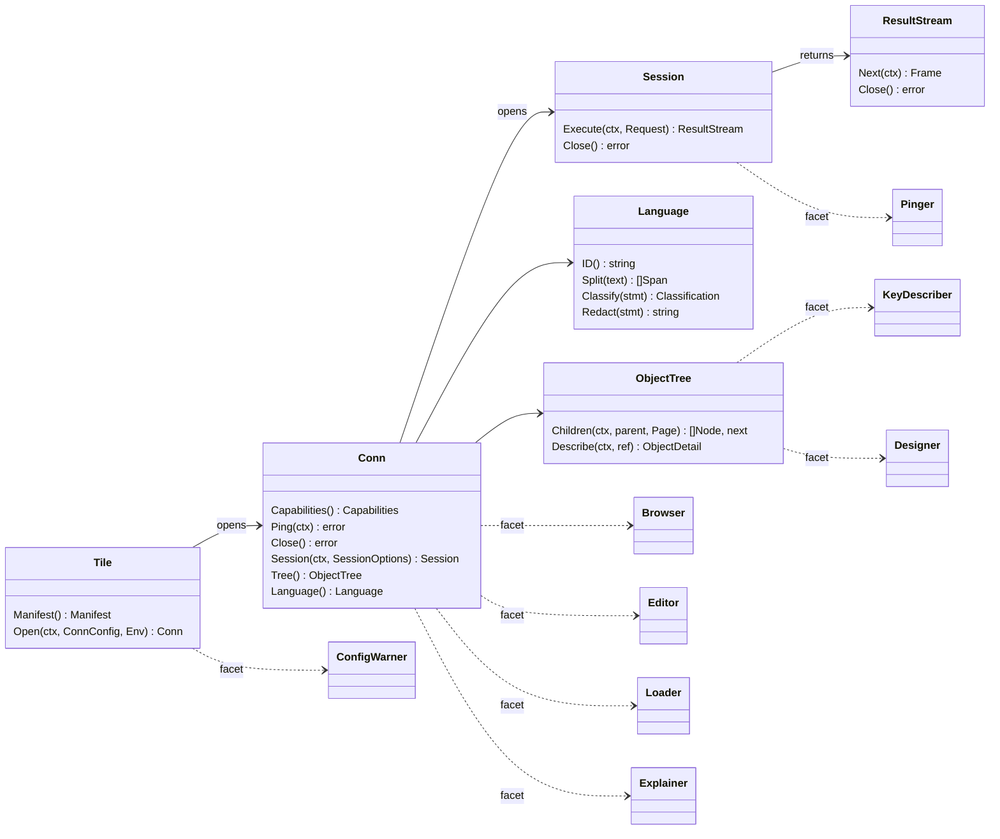
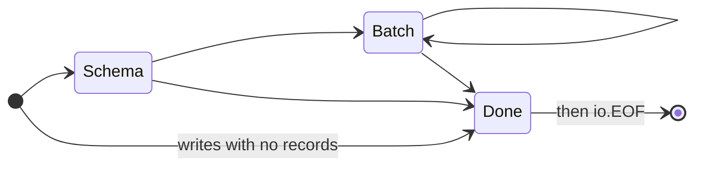

The [`tile`](https://github.com/arunksoman/tessera/blob/main/tile/tile.go) package is the plugin contract. It imports only the standard library. Its JSON tags are also the [wire format](/plugins/protocol/), pinned by a test, so a Go field can be renamed without breaking a plugin. `tile.APIVersion` is `0`.



## Tile and Manifest

```go
type Tile interface {
	Manifest() Manifest
	Open(ctx context.Context, cfg ConnConfig, env Env) (Conn, error)
}
```

| Manifest field | Meaning |
|---|---|
| `ID` | The tile's identifier, such as `postgres`. A plugin's ID must equal the name it is installed under, and can never be a built-in tile's ID. |
| `Name` | The name shown to users, such as `PostgreSQL`. |
| `APIVersion` | Always `tile.APIVersion`. The host refuses a mismatch at handshake. |
| `Style` | A `Color` from the palette (`lapis`, `verdigris`, `ochre`, `terracotta`, `porphyry`, or `slate`) and a short `Glyph`, such as `P`, shown in the TUI. |
| `ConnForm` | The connection form every front-end renders. |
| `Version` | Your plugin's semantic version. Built-in tiles leave it empty. |
| `MinTess`, `MaxTess` | The tess versions you work with, inclusive. Prefer `MinTess` alone: a maximum also blocks later releases that would have worked. |
| `Stability` | `alpha`, `beta`, or `stable`. tess refuses any other value and shows it beside your version. |

`ConnForm.Fields` are `FormField`s with a `Name`, `Label`, `Type` (`text`, `int`, `bool`, `enum`, `secret`, `file`), `Required`, `Options` for enums, and a `Default`. Users set fields with `--set NAME=VALUE`; `host`, `port`, `user`, `database`, and `socket` also have flags.

`Open` receives `ConnConfig.Values`, the validated form values without secrets, and an `Env`:

- `Env.Secret(ctx, name)` returns a stored secret such as `"password"`, or empty if none is set. Across the plugin boundary this is a call back to the host, scoped to this connection.
- `Env.Dial` is the host's dialer for tunnels and dial policy. It is not carried to plugins yet; dial directly for now.

Build your driver's configuration **field by field**. Never accept a connection string from the user, and keep the password out of anything that could appear in an error. Default TLS to verifying the certificate and host name.

## Conn

```go
type Conn interface {
	Capabilities() Capabilities
	Ping(ctx context.Context) error
	Close() error
	Session(ctx context.Context, opt SessionOptions) (Session, error)
	Tree() ObjectTree
	Language() Language
}
```

A `Conn` is a logical connection, usually a pool. `Capabilities` maps names to `CapInfo{Supported, Note}`; a `Note` lets the UI explain a limitation instead of hiding it. Unknown capabilities are ignored.

| Capability | Meaning |
|---|---|
| `tx.multi` | A session can hold a multi-statement transaction. Without it, front-ends show no transaction state and edit plans run per item. |
| `tx.ddl` | Statements with `Classification.Schema` run inside a transaction instead of committing it. |
| `exec.cancel` | Cancelling a statement stops it on the server. |
| `exec.stream` | Results stream rather than arriving all at once. |
| `exec.readonly.server` | The server enforces read-only sessions. |
| `data.ttl` | Records can expire, as keys do in key-value stores. |

## Session and results

```go
type Session interface {
	Execute(ctx context.Context, req Request) (ResultStream, error)
	Close() error
}
```

A session is one physical connection holding transaction and session state. It runs one request at a time. When `SessionOptions.ReadOnly` is set, enforce read-only on the server if you can. **`Close` must reset state**, or discard the connection, so read-only mode and settings never leak into the next session from a pool.

`Request` carries `Text`, opaque text in your language, and `Args`, values that are always bound and never spliced into the text.

```go
type ResultStream interface {
	Next(ctx context.Context) (Frame, error) // io.EOF after the last frame
	Close() error
}
```

A `Frame` has exactly one field set, in this order:



- `Schema` has a `Shape` and the `Fields` (name, native type, kind).
- `Batch` has `Rows` and `Cells`, row-major, exactly `len(Fields) * Rows` long. The host checks this.
- `Done` is a `ResultSummary`: `RowsAffected` with `HasAffected`, a `Tag` such as `INSERT 0 1`, and a `Cursor` for cursor-paged browsing.

Streams are pull-based: not calling `Next` is the backpressure, so fetch from the database lazily inside `Next` with batches of reasonable size (the built-in tiles use about 1,000 rows or 1 MiB). **Cancelling the context, or closing the stream early, must stop the server's work promptly.** A `Value.Raw` slice is valid only until the next `Next`, so you may reuse buffers.

### Values

A `Value` is a `Kind` and canonical bytes in `Raw`:

| Kind | Raw holds |
|---|---|
| `KindNull` | nothing |
| `KindBool` | `true` or `false` |
| `KindInt` | canonical decimal text, never a float, so 64-bit and larger integers survive JavaScript |
| `KindDecimal` | canonical decimal text with its full scale |
| `KindFloat` | decimal text |
| `KindText` | UTF-8 text |
| `KindBytes` | raw bytes (base64 on the wire) |
| `KindTime` | RFC 3339 text, with as many fractional digits as the database keeps |
| `KindJSON` | JSON text; types JSON lacks use canonical Extended JSON |
| `KindOther` | text in the database's own format |

### Shapes

`ShapeTabular` (rows of fields), `ShapeDocument` (usually a key and the whole document as `KindJSON`), `ShapeKeyValue` (key, type, ttl, value), `ShapeTree`, and `ShapeScalar` say how a result is best shown. Every shape is still fields and batches, so any front-end can fall back to a table.

## Language

```go
type Language interface {
	ID() string
	Split(text string) []Span
	Classify(stmt string) Classification
	Redact(stmt string) string
}
```

The engine never looks inside your language; everything it knows comes from here. **This is safety-relevant code.**

- `Split` returns the byte spans of each statement in a script. It must understand your comments and quoting, so a `;` inside a string or a body does not split a statement. It must never fail on invalid input.
- `Classify` returns a `Classification`:

  | Field | Meaning |
  |---|---|
  | `Verb` | The statement's verb, shown in prompts |
  | `Risk` | `RiskNone`, `RiskWrite`, or `RiskDestructive` |
  | `ReadOnly` | No write was visible in the text |
  | `Reason` | Why it is risky, shown in confirmation prompts |
  | `Tx` | `TxBegin`, `TxEnd`, or `TxNone`: the effect on an open transaction, so front-ends can track it |
  | `Schema` | The statement defines objects. It refreshes the tree and completion, and where `tx.ddl` is unsupported it ends an open transaction. |

  Be **default-deny**: unknown statements are writes. Look for writes hidden inside reads, such as a `DELETE` in a CTE. Classification is a guardrail, not a boundary: a called function can still write.
- `Redact` removes secrets, such as `PASSWORD '...'`, before a statement reaches history, audit, or logs.

`Completer` is an optional facet of `Language` for completion. It is not carried across the plugin protocol yet.

## ObjectTree

```go
type ObjectTree interface {
	Children(ctx context.Context, parent ObjectRef, p Page) (nodes []Node, next string, err error)
	Describe(ctx context.Context, ref ObjectRef) (ObjectDetail, error)
}
```

An `ObjectRef` is a path of `Segment{Kind, Name}`, as deep as your database needs: schema, table; database, collection; or key prefixes. `Children` of the empty ref are the roots. Children are always paginated: return at most `Page.Limit` nodes and a cursor for the next page, empty on the last.

A `Node` has its `Ref`, a `Kind` (`table`, `view`, `function`, or your own), a `Label`, `HasChildren`, `Browsable` when it can be opened as data, and an optional `Detail` such as a parameter list.

`Describe` returns sections of fields and rows for the object's detail view.

## Optional facets

Implement a facet by adding its methods to the same type. Across the plugin boundary the plugin reports which facets it has, so the host's type assertions still work.

| Facet | On | Methods | Purpose |
|---|---|---|---|
| `KeyDescriber` | tree | `DescribeKeys(ctx, ref) (Keys, error)` | Primary key and foreign keys, for grid marks and following references |
| `Designer` | tree | `DescribeStructure`, `PlanStructure`, `CreateScript` | Read and change fields, indexes, relations, and triggers |
| `Browser` | conn | `Layout(ctx, ref)`, `BrowseRequest(ref, layout, query)` | Page through one object's records with sort and filter |
| `Editor` | conn | `Plan(ref, layout, changes) (Plan, error)` | Turn cell edits into exact, guarded statements |
| `Loader` | conn | `InsertPlan`, `InsertScript` | Import rows, and export them as statements |
| `Explainer` | conn | `ExplainRequest(stmt, format) Request` | Build a request that plans a statement without running it |
| `Pinger` | session | `Ping(ctx) error` | Check a long-lived session is still alive |
| `ConfigWarner` | tile | `ConfigWarnings(cfg) []string` | Name weak settings, such as TLS off |

### Browsing

`Layout` describes an object's `Fields`, its `Key` (empty means records cannot be edited, with a `Note` saying why), an `Estimate` of its size (negative if unknown), a `Paging` mode, and a `Shape`.

`BrowseRequest` builds the request for one page from a `BrowseQuery`: `Sort` keys, `Filter` conditions (ANDed, with operators `=`, `!=`, `<`, `<=`, `>`, `>=`, `~` for contains, `null`, and `!null`), and the position. It does no I/O. A tile that cannot apply an operator to a field returns an error rather than ignoring it.

- `PagingKeyset`: with a `Key`, the host sends the last record of the previous page as `After`; without one, it sends `Offset`.
- `PagingCursor`: the host sends the previous page's `ResultSummary.Cursor`. A page may be short while more remain; only an empty cursor ends the browse.

### Plans

`Editor.Plan`, `Designer.PlanStructure`, and `Loader.InsertPlan` return a `Plan`: optional `Begin`, `Commit`, and `Rollback` requests, the `Steps`, and its `Atomicity` (`AtomicAll`, or `AtomicPerItem` when the store has no transactions). Each `PlanStep` has the `Request` to run, a `Preview` with values rendered as literals for the user to read, and `ExpectRows`, how many records it must change (negative means unchecked).

Planning **has no side effects**: the host shows the preview, hashes the plan, and runs exactly what was shown. For edits, a `Change` carries the record's `Key` values, the new values in `Set`, and in `Old` the values the user saw. Use `Old` in your guard, so a record changed by someone else matches nothing; the host then rolls back and reports a conflict.

Values in a plan are always bound arguments. The only text placed into statements as written is what a user typed as code: a type name, a default expression, or a trigger body.

### Structure

`DescribeStructure` returns `Fields` (name, native type, nullable, default expression, comment, primary, collation, and `Extra` attributes to send back unchanged), `Indexes`, `Relations` (foreign keys with `OnUpdate` and `OnDelete` from `RelationActions`), and `Triggers`. `PlanStructure` takes `StructureChange`s with an op: `rename`, `truncate`, `drop`, `field.add`, `field.alter`, `field.drop`, `index.add`, `index.drop`, `relation.add`, `relation.drop`, `trigger.add`, and `trigger.drop`. Refuse what your database cannot do, rather than doing something else.
