A plugin adds a database to Tessera without changing tess. It is an ordinary program that tess starts on first use and talks to over standard input and output. Every front-end, the safety gate, history, and audit work with it exactly as with a built-in database.

This section is for anyone building one: in Go with Tessera's packages, or in any language with the [wire protocol](/plugins/protocol/).

## The pieces

| Package | What it is |
|---|---|
| [`tile`](https://github.com/arunksoman/tessera/blob/main/tile/tile.go) | The contract: the Go interfaces and types a database implements. Standard library only. |
| [`tile/plugin`](https://github.com/arunksoman/tessera/tree/main/tile/plugin) | Runs a tile as a plugin. `plugin.Serve(t)` in `main` is all a Go plugin needs. Standard library only. |
| [`tile/tiletest`](https://github.com/arunksoman/tessera/tree/main/tile/tiletest) | The conformance suite every built-in tile passes, plus `OutOfProcess` to test a tile across the process boundary. |

```mermaid
architecture-beta
    group host(logos:go)[tess host process]
    service engine(server)[Engine and safety gate] in host
    service client(server)[plugin Client] in host

    group child(logos:go)[Your plugin process]
    service serve(server)[plugin Serve] in child
    service tile(server)[Your Tile] in child

    service db(database)[Your database]

    engine:R --> L:client
    client:R <--> L:serve
    serve:R --> L:tile
    tile:R --> L:db
```

The host and the plugin exchange newline-delimited JSON over the plugin's standard input and output, and either side may send requests: the plugin calls back for secrets while the host waits on it.

The host wraps the process in the same `tile.Tile` interface the built-in tiles implement, so nothing in tess can tell the two apart.

## What you implement

A **tile** has a manifest and opens **connections**. A connection opens **sessions**, which run **requests** and stream **results**. A connection also has a **language**, which tess uses to split scripts and classify statements for the safety gate, and optionally an **object tree** for the browser.

| Interface | Required | Gives users |
|---|:-:|---|
| `Tile` with `Manifest` and `Open` | yes | The database in the connection pickers, with a connection form |
| `Conn` | yes | Connections, capabilities, ping |
| `Session` and `ResultStream` | yes | Running statements and streaming results in every front-end |
| `Language` | yes | Script splitting, the safety gate, redacted history |
| `ObjectTree` | return `nil` to skip | The object tree in the TUI and web app |
| `KeyDescriber` (tree facet) | | Key and foreign-key marks, following references |
| `Browser` (conn facet) | | Browsing an object with server-side sort, filter, and paging |
| `Editor` (conn facet) | | Inline editing with preview and conflict checks |
| `Loader` (conn facet) | | Import, and export as statements |
| `Designer` (tree facet) | | The structure designer and create scripts |
| `Explainer` (conn facet) | | Explain in the TUI |
| `Pinger` (session facet) | | Health checks on long-lived sessions |
| `ConfigWarner` (tile facet) | | Warnings for weak settings, such as TLS off |

Optional features are separate interfaces, called **facets**. Implement the ones your database can do; front-ends hide what is missing. See [The tile contract](/plugins/contract/) for every type.

## Rules every tile follows

These invariants are what make Tessera safe and fast. The conformance suite checks most of them.

1. **Stream, never collect.** Results flow as one `Schema` frame, then `Batch` frames, then `Done`, pulled one at a time through `ResultStream.Next`. Not calling `Next` is the backpressure. Never load a whole result into memory.
2. **Cancel must stop the server.** When the context is cancelled, or a stream is closed early, the database must stop working promptly, not only the client.
3. **Values are lossless.** Integers and decimals travel as canonical decimal text, never through a float. Times are RFC 3339 text.
4. **Classify default-deny.** Anything your `Language` does not recognise as a read is a write. A mistake here is a safety bug.
5. **Bind arguments, never splice.** `Request.Args` are always bound by the driver. Identifiers you build go through your database's quoting.
6. **Build connections field by field.** Never accept a raw connection string from the user; a value must not be able to inject another setting.
7. **Verify TLS by default.** If your database has TLS, default to verifying the certificate and host name.
8. **Sessions reset on close.** Read-only mode and session settings must not leak to the next user of a pooled connection.
9. **Plans have no side effects.** `Plan`, `PlanStructure`, `InsertPlan`, and `BrowseRequest` only build requests. The host runs them.
10. **Ask the host for secrets.** Passwords come only from `Env.Secret`, never from `ConnConfig` or the environment.

## Nothing here assumes SQL

`Request.Text` is opaque text in your database's language: a SQL statement, a key-value command, or a JSON query document. The object tree is whatever your database has: schemas and tables, databases and collections, or key prefixes. Results declare a `Shape` (tabular, document, key-value, tree, scalar) so front-ends can choose how to show them, but every shape is still fields and rows, so any front-end can fall back to a table.

## Stability

The contract is **v0**. It can change until NoSQL tiles have proven it, after which `v1` will only add. Within a major version, changes are additions only: new facets, capabilities, and optional fields. Tiles declare features through facets and capabilities, not version checks.

## Next

- [Tutorial: write a plugin](/plugins/tutorial/) in Go, test it, and install it into tess.
- [The tile contract](/plugins/contract/): every type and what it must do.
- [The wire protocol](/plugins/protocol/), for plugins in other languages.
- [Testing](/plugins/testing/) with the conformance suite.
- [Publishing](/plugins/publishing/): descriptors, signing, and releases.
