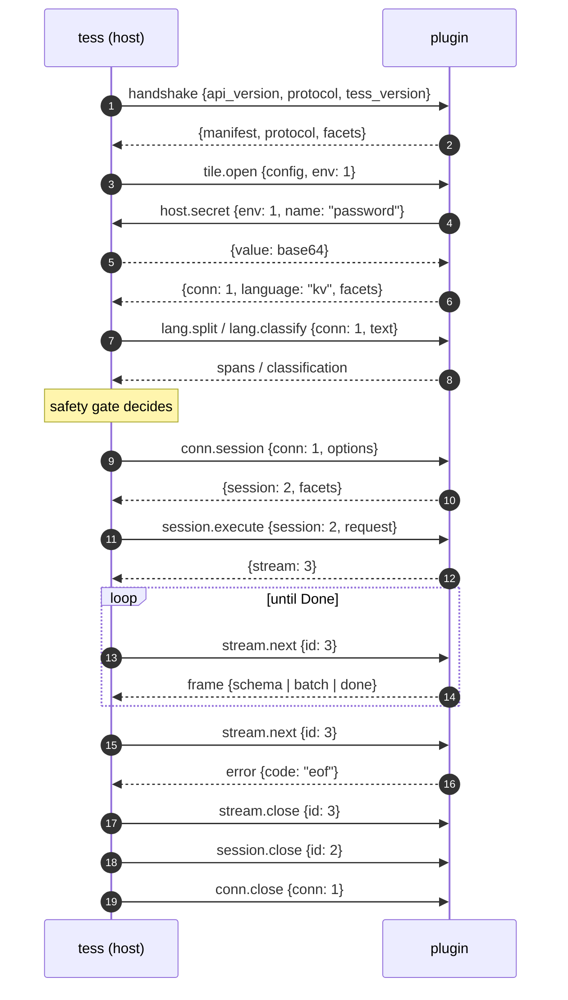

A Go plugin never sees this protocol: `plugin.Serve` speaks it. Read this page to write a plugin in another language, or to debug one. The protocol is revision `1` of tile API `0`.

## Transport

tess starts the plugin binary with no arguments and an [allowlisted environment](#environment), then talks to it over the plugin's standard input (host to plugin) and standard output (plugin to host). Standard error is not part of the protocol.

- Each message is **one JSON object on one line**, ending in `\n`.
- A message is at most **64 MiB**.
- **Either side may send requests.** Request ids are per sender, so the host's id 7 and the plugin's id 7 are unrelated.
- Requests may be outstanding concurrently; answer each with its id, in any order.

| Message | Shape |
|---|---|
| Request | `{"id": 1, "method": "tile.open", "params": {...}}` |
| Success | `{"id": 1, "result": ...}` (omit `result` or send `null` for no value) |
| Failure | `{"id": 1, "error": {"code": "", "message": "..."}}` |
| Cancel | `{"cancel": 1}`: stop the request with that id; it still gets a response |

Error `code` is empty for ordinary errors, `eof` for the end of a stream, `canceled` when a request was cancelled, and `deadline` when its deadline passed. The host strips control characters from error text and caps it at 4 KiB before it can reach a terminal.

Tile types travel in their `encoding/json` form using the JSON names in [the contract](https://github.com/arunksoman/tessera/blob/main/tile/tile.go). Byte slices, including `Value.raw`, are **base64**. Enum-like numbers (`kind`, `risk`, `shape`, `tx`, `atomicity`, `paging`, `format`) are integers in the order the contract declares them, starting at 0.

## A session, start to finish



Connections, sessions, and streams are **handles**: numbers the plugin chooses, unique for the life of the process. Closing the plugin's standard input means the host is done; exit promptly.

## Handshake

The host's first request, which must be answered within 15 seconds:

```json
{"id":1,"method":"handshake","params":{"api_version":0,"protocol":1,"tess_version":"0.5.0"}}
```

Refuse an `api_version` you do not speak with an error. Reply with your manifest, `protocol: 1`, and your tile-level facets:

```json
{"id":1,"result":{"manifest":{"id":"kv","name":"Key-value file","api_version":0,"style":{"color":"porphyry","glyph":"K"},"conn_form":{"fields":[{"name":"path","label":"Store file","type":"file","required":true}]},"version":"0.1.0","min_tess":"0.5.0","stability":"alpha"},"protocol":1,"facets":{}}}
```

The host refuses a different `protocol`, a manifest whose `id` differs from the installed name, a `min_tess` or `max_tess` that excludes it, or an unknown `stability`.

## Facets

A type assertion cannot cross a process, so the plugin reports its optional interfaces as booleans, in three places:

| Reported in | Facets |
|---|---|
| `handshake` reply | `config_warner` |
| `tile.open` reply | `tree`, `tree_keys`, `tree_design`, `browser`, `editor`, `explainer`, `loader` |
| `conn.session` reply | `pinger` |

The host only calls methods of facets you reported.

## Methods the host calls

Connection-level requests carry `conn`, the handle from `tile.open`.

| Method | Params | Result |
|---|---|---|
| `handshake` | `{api_version, protocol, tess_version}` | `{manifest, protocol, facets}` |
| `tile.config_warnings` | `ConnConfig` `{values}` | `["warning", ...]` |
| `tile.open` | `{config: {values}, env}` | `{conn, language, facets}` |
| `conn.capabilities` | `{conn}` | `{"tx.multi": {supported, note}, ...}` |
| `conn.ping` | `{conn}` | none |
| `conn.close` | `{conn}` | none |
| `conn.session` | `{conn, options: {read_only}}` | `{session, facets}` |
| `tree.children` | `{conn, parent: ObjectRef, page: {cursor, limit}}` | `{nodes, next}` |
| `tree.describe` | `{conn, ref}` | `ObjectDetail` |
| `tree.keys` | `{conn, ref}` | `Keys` |
| `tree.structure` | `{conn, ref}` | `Structure` |
| `tree.plan_structure` | `{conn, ref, changes}` | `Plan` |
| `tree.create_script` | `{conn, ref}` | `"text"` |
| `lang.split` | `{conn, text}` | `[{start, end}, ...]` |
| `lang.classify` | `{conn, text}` | `Classification` |
| `lang.redact` | `{conn, text}` | `"text"` |
| `browser.layout` | `{conn, ref}` | `Layout` |
| `browser.request` | `{conn, ref, layout, query}` | `Request` |
| `editor.plan` | `{conn, ref, layout, changes}` | `Plan` |
| `loader.insert_plan` | `{conn, ref, fields, rows}` | `Plan` |
| `loader.insert_script` | `{conn, ref, fields, rows}` | `"text"` |
| `explainer.request` | `{conn, text, format}` | `Request` |
| `session.execute` | `{session, request: {text, args}}` | `{stream}` |
| `session.ping` | `{id}` | none |
| `session.close` | `{id}` | none |
| `stream.next` | `{id}` | `Frame`, or error code `eof` after the last |
| `stream.close` | `{id}` | none |

`env` in `tile.open` names this connection's environment for `host.secret` calls. Spans in `lang.split` are byte offsets into the UTF-8 text.

## The method the plugin calls

| Method | Params | Result |
|---|---|---|
| `host.secret` | `{env, name}` | `{value: base64}`, empty if not set |

The host answers only for an `env` it handed to an open that has not closed, so a plugin sees only the secrets of its own connections.

## Streams and cancel

- One `stream.next` per frame. Not calling it is the backpressure, so produce frames lazily.
- The host checks frame order (`schema`, then `batch`es, then `done`) and that each batch has rows × fields cells, and fails the stream otherwise.
- A stream outlives the `session.execute` call that created it; its work ends when the stream is closed.
- When the host cancels, it sends `{"cancel": id}`. Stop that request's work, **on the database server too**, and answer it with error code `canceled`. The host waits up to 5 seconds for it, so the server-side cancel can finish.

## Failing safe

When a plugin cannot answer, because it crashed, hung, or returned an error, the host does not guess in the plugin's favour: `lang.classify` counts as destructive, `lang.redact` hides the whole statement, `lang.split` treats the text as one statement, and `explainer.request` returns an empty request, never the statement itself.

## Environment

A plugin process receives only these environment variables, when set: `PATH`, `HOME`, `USER`, `USERPROFILE`, `SYSTEMROOT`, `SYSTEMDRIVE`, `WINDIR`, `COMSPEC`, `TEMP`, `TMP`, `TMPDIR`, `APPDATA`, `LOCALAPPDATA`, `PROGRAMDATA`, `LANG`, `LC_ALL`, `LC_CTYPE`, `TZ`, `SSL_CERT_FILE`, `SSL_CERT_DIR`, the `HTTP_PROXY`, `HTTPS_PROXY`, and `NO_PROXY` variables in either case, `XDG_CONFIG_HOME`, `XDG_CACHE_HOME`, and `XDG_RUNTIME_DIR`. `TESSERA_*` variables, cloud credentials, and everything else stay with tess.

## Not carried yet

`Env.Dial` (plugins dial for themselves) and the `Completer` language facet.
