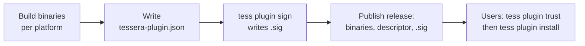
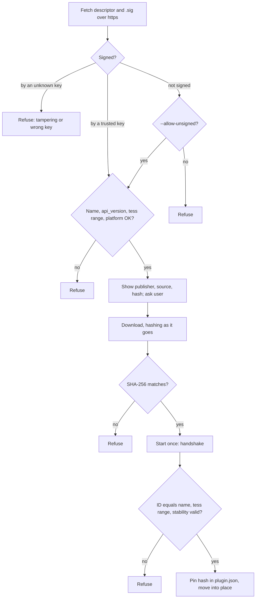

Users install a plugin from a **descriptor**, `tessera-plugin.json`, which lists a binary and its SHA-256 for each platform. You sign the descriptor with an Ed25519 key, and users trust your public key once.



## 1. Build release binaries

Build one binary per platform you support, named however you like. Set your version at build time so the manifest and descriptor agree:

```sh
for target in linux/amd64 linux/arm64 darwin/amd64 darwin/arm64 windows/amd64; do
  os=${target%/*} arch=${target#*/}
  ext=$([ "$os" = windows ] && echo .exe)
  GOOS=$os GOARCH=$arch CGO_ENABLED=0 go build -trimpath \
    -ldflags "-s -w -X main.version=$VERSION" -o "dist/tess-kv-$os-$arch$ext" .
done
```

A pure-Go plugin cross-compiles like this. A plugin on a cgo driver, like DuckDB, must build on each platform; see the [DuckDB release workflow](https://github.com/arunksoman/tessera/blob/main/.github/workflows/release-duckdb.yml) for a matrix that does.

## 2. Write the descriptor

```json
{
  "name": "kv",
  "version": "0.1.0",
  "api_version": 0,
  "description": "Key-value files",
  "homepage": "https://github.com/acme/tess-kv",
  "min_tess": "0.5.0",
  "artifacts": {
    "linux/amd64":   {"url": "tess-kv-linux-amd64",       "sha256": "…"},
    "linux/arm64":   {"url": "tess-kv-linux-arm64",       "sha256": "…"},
    "darwin/arm64":  {"url": "tess-kv-darwin-arm64",      "sha256": "…"},
    "windows/amd64": {"url": "tess-kv-windows-amd64.exe", "sha256": "…"}
  }
}
```

| Field | Meaning |
|---|---|
| `name` | The name users install, lowercase, at most 32 characters. Must equal the manifest's `ID`. |
| `version` | Your semantic version. tess refuses to replace an installed version with an older one unless the user passes `--allow-downgrade`. |
| `api_version` | The tile API version, `0`. |
| `description`, `homepage` | Shown at install. |
| `min_tess`, `max_tess` | Optional inclusive bounds on tess versions, checked before download. Prefer `min_tess` alone. |
| `artifacts` | Keyed by `GOOS/GOARCH`. `url` may be relative to the descriptor, or an absolute https URL. |

The descriptor is capped at 1 MiB and each binary at 512 MiB. Produce the artifact map with `sha256sum` and `jq`:

```sh
cd dist
artifacts='{}'
for bin in tess-kv-*; do
  target=${bin#tess-kv-}; target=${target%.exe}
  artifacts=$(jq --arg t "${target/-//}" --arg u "$bin" --arg s "$(sha256sum "$bin" | cut -d' ' -f1)" \
    '. + {($t): {url: $u, sha256: $s}}' <<<"$artifacts")
done
jq -n --arg v "$VERSION" --argjson a "$artifacts" \
  '{name: "kv", version: $v, api_version: 0, min_tess: "0.5.0", artifacts: $a}' > tessera-plugin.json
```

## 3. Sign it

Create a signing key once and keep it secret, for example in your CI's secret store. `keygen` prints the public key to give your users:

```sh
tess plugin keygen --out acme.key          # prints the base64 public key; refuses to overwrite a file
tess plugin sign --key acme.key dist/tessera-plugin.json     # writes dist/tessera-plugin.json.sig
```

The signature is Ed25519 over the exact descriptor bytes with a domain-separation prefix, base64 in the `.sig` file. Any later change to the descriptor, even whitespace, invalidates it, so sign last.

## 4. Publish

Put the binaries, `tessera-plugin.json`, and `tessera-plugin.json.sig` in one place on https. On GitHub, attach them to a release; tess finds them with no API calls:

```sh
gh release create v0.1.0 dist/* --notes "..."
```

Tell users your public key and the install command, ideally in the release notes:

```sh
tess plugin trust acme "BASE64-PUBLIC-KEY"
tess plugin install kv --from github:acme/tess-kv           # latest release
tess plugin install kv --from github:acme/tess-kv@v0.1.0    # a tag
```

If your repository's latest release is something else, as with the DuckDB plugin in the Tessera repository, users must name the tag.

## What tess checks at install



Before every later start, tess hashes the binary again and refuses to run it if it changed.

## Versioning and stability

- Set `MinTess` in the manifest and `min_tess` in the descriptor to the oldest tess you tested. tess checks the descriptor before download and the binary's own manifest at every start. A development build of tess counts as newer than every release.
- Set `Stability` to `alpha`, `beta`, or `stable`. Users see it beside your version in `tess plugin list` and the connection pickers.
- The contract is v0: watch the [tile package](https://github.com/arunksoman/tessera/blob/main/tile/tile.go) for changes before you raise `min_tess`.

## Publishing checklist

- [ ] The manifest's `ID` equals the descriptor's `name`.
- [ ] `Version` in the binary equals `version` in the descriptor.
- [ ] Tests pass in process and with `tiletest.OutOfProcess`.
- [ ] TLS verifies by default, and connection settings are built field by field.
- [ ] `Classify` is default-deny, and `Split` is fuzzed.
- [ ] Cancel and early close stop the server's work.
- [ ] Nothing is printed to standard output.
- [ ] The descriptor is signed last, and the public key is in the release notes.
