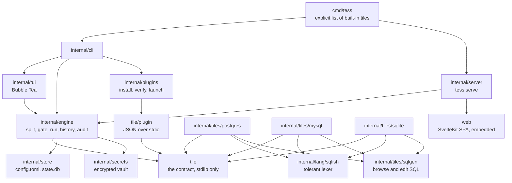
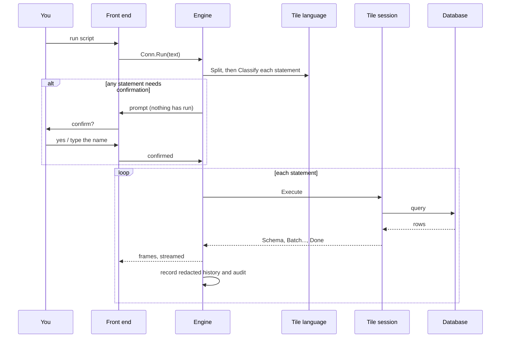

Tessera is one Go module that builds one binary, `tess`, with `CGO_ENABLED=0`. The web app is a SvelteKit single-page app embedded into that binary. The full design, including parts not built yet, is in [design.md](https://github.com/arunksoman/tessera/blob/main/design-spec/design.md).

## Dependencies point one way

- **`tile`** is the plugin contract. It imports only the standard library and assumes nothing about SQL. New features arrive as new optional interfaces, never as new methods on existing ones.
- **`internal/engine`** is what every front-end shares. `Conn.Run` splits a script, passes every statement through the safety gate before any runs, then records redacted history and audit. Front-ends go through it, never to tiles directly.
- **`internal/lang/sqlish`** is a lexer that never fails on invalid input, used for splitting, classification, and redaction across the SQL dialects. A comment or quoting mistake there is a safety bug, so it is fuzzed.
- **`internal/server`** serves `/api` through the engine. Statement results stream to the browser as NDJSON; statements that need confirmation return 409 with the prompts, and the browser asks and retries.
- **`internal/tui`** runs workers that report back through events and never touch model state. One action registry drives keys, the palette, and help.

## A statement's path

## Invariants

- **Streaming.** Results flow as `Schema`, `Batch`, `Done` frames pulled one at a time. Nothing collects a whole result.
- **Lossless values.** Values stay canonical bytes; integers and decimals never pass through a float.
- **Cancel stops the server.** PostgreSQL uses a server cancel; MySQL uses `KILL QUERY` on a second connection.
- **Connection settings are built field by field** from form values, never from user-supplied connection strings, and TLS verifies by default.
- **The engine never matches statement verbs.** Transaction state and schema changes come from each tile's `Classification`, so non-SQL languages work.
- **Sessions reset on close,** so state cannot leak through a pool.
- **Edits are planned.** Plans have no side effects, and the engine checks the plan's hash so the text previewed is the text run.

## Repository layout

| Path | Contents |
|---|---|
| `cmd/tess` | `main`, `tess serve` flags |
| `tile`, `tile/plugin`, `tile/tiletest` | The public plugin API and conformance suite |
| `internal/…` | Everything private to tess |
| `plugins/duckdb` | The DuckDB plugin, its own Go module because it needs cgo |
| `web` | The SvelteKit web app |
| `docs` | This site (Astro Starlight), and the example plugin in `docs/examples` |
| `design-spec` | Design, task list, and spike measurements |
| `test/fixtures` | Fixture databases and the Sakila sample |
