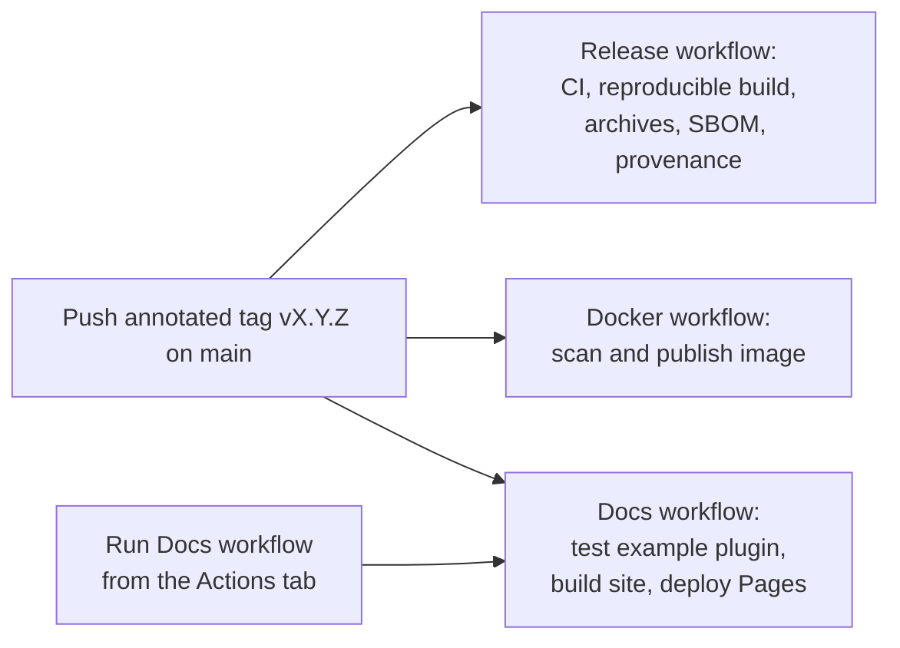

Tessera is developed test-first. [CLAUDE.md](https://github.com/arunksoman/tessera/blob/main/CLAUDE.md) holds the working rules and commands, and [task.md](https://github.com/arunksoman/tessera/blob/main/design-spec/task.md) is the checklist that drives the work.

## Build and test

You need Go 1.26, Node.js 22 for the web app and docs, and Docker for the database tests.

```sh
make                                    # web app, then tess; `make help` lists targets
go test ./...                           # unit tests, including SQLite's conformance suite
docker compose up -d --wait             # PostgreSQL 18, MySQL 8.4, MariaDB 11.4
go test -tags integration ./internal/tiles/... ./internal/cli/... ./internal/tui/...
```

Every direct dependency, of tess or of a plugin, needs a justification in section 11 of the design; `scripts/check-deps.sh` checks it. `tess` must build with `CGO_ENABLED=0`. All frontend work needs light and dark themes.

## Work on the docs

The docs are an [Astro Starlight](https://starlight.astro.build) site in `docs/`. Pages are Markdown or MDX in `docs/src/content/docs/`, and the sidebar follows the folders.

```sh
cd docs
npm ci --ignore-scripts
npm run dev          # http://localhost:4321/tessera/
npm run build        # into docs/dist
```

- **Links** between pages are written from the site root, such as `/guides/web/`; the build adds the `/tessera` base.
- **Versions** in install commands are placeholders, listed in `vars` in `docs/astro.config.mjs`; the build fills in the newest release tags.
- **Diagrams** are Mermaid code blocks, rendered in the reader's theme. Architecture diagrams can use the `logos:` icons listed in `docs/astro.config.mjs`.
- **Screenshots** come in pairs, `NAME-light.png` and `NAME-dark.png` in `docs/src/assets/screens/`, shown with `<Screenshot name="NAME" alt="..." />`, which displays the one matching the reader's theme.
- **The tutorial's plugin** is real code in `docs/examples/tess-kv`, tested in the docs workflow. Edit it there; the tutorial embeds the files.

### Retake screenshots

Screenshots are taken from the real app against the Sakila sample database, never edited by hand. With the compose databases up:

```sh
make
PLAYWRIGHT_DIR=<dir with playwright installed> node docs/scripts/screenshots.mjs   # web app, both themes
docs/scripts/tui-screenshots.sh 0.5.0                                             # TUI, with VHS in Docker
```

The scripts never write to a database: edits are previewed and discarded, and the safety prompt is cancelled.

## Releases and docs publishing



Push an annotated version tag on a commit in `main`; the tag message becomes the release notes:

```sh
git tag -a v0.6.0 -m "Release notes here"
git push origin v0.6.0
```

The same tag publishes the docs, so the site always matches the newest release. To publish doc fixes between releases, run the **Docs** workflow from the Actions tab (`gh workflow run docs.yml`). Pull requests that touch `docs/` build the site without publishing it.
