import Screenshot from '../../../components/Screenshot.astro';

Tessera is an open-source database client. You install one program, `tess`, and use it three ways:

- **`tess query`** runs SQL from the shell and streams results as a table, CSV, or JSON.
- **`tess tui`** opens a terminal UI with an object tree, a SQL editor, and a result grid.
- **`tess serve`** opens a web app in your browser with the same features and more, such as a table designer and import.

A *tessera* is one tile in a mosaic. In Tessera each database is a tile: PostgreSQL, MySQL and MariaDB, and SQLite are built in, and other databases, such as [DuckDB](/databases/duckdb/), come as plugins. Together they form one picture of your data.

<Screenshot name="web-sql" alt="The web app with a SQL tab open on the Sakila database" />

## What you can do

| Task | CLI | TUI | Web |
|---|:-:|:-:|:-:|
| Save connections with encrypted passwords | ✓ | ✓ | ✓ |
| Run statements and scripts, with cancel on the server | ✓ | ✓ | ✓ |
| Export results as CSV or JSON | ✓ | | ✓ (and JSON Lines) |
| Browse schemas, tables, views, and routines | | ✓ | ✓ |
| Browse a table with server-side sort, filter, and paging | | ✓ | ✓ |
| Edit cells, preview the SQL, apply in one transaction | | ✓ | ✓ |
| Explain a statement | | ✓ | |
| Command palette and statement history | history | ✓ | |
| Follow a foreign key to the row it refers to | | | ✓ |
| Change table structure: columns, indexes, relations, triggers | | | ✓ |
| Rename, truncate, and drop tables; create scripts | | | ✓ |
| Import CSV, JSON, and JSON Lines; export whole tables, also as SQL | | | ✓ |
| Install, verify, and remove plugins | ✓ | | |

## Status

Tessera is in early development. The CLI, TUI, and web app are usable every day on PostgreSQL, MySQL, MariaDB, and SQLite, and releases are reproducible, signed, and come with an SBOM. The plugin contract is at version 0, so it can still change. The [roadmap](https://github.com/arunksoman/tessera/blob/main/design-spec/task.md) lists what is done and what comes next.

## How it fits together

```mermaid
architecture-beta
    group fe(cloud)[Front ends]
    service cli(logos:terminal)[tess query] in fe
    service tui(logos:terminal)[tess tui] in fe
    service web(logos:chrome)[tess serve] in fe

    group core(server)[Engine]
    service gate(server)[Safety gate] in core
    service store(disk)[History audit vault] in core

    group dbs(database)[Tiles]
    service pg(logos:postgresql)[PostgreSQL] in dbs
    service my(logos:mysql)[MySQL MariaDB] in dbs
    service lite(logos:sqlite)[SQLite] in dbs
    service duck(logos:duckdb)[DuckDB plugin] in dbs

    cli:R -- L:tui
    tui:R -- L:web
    tui:B --> T:gate
    gate:R -- L:store
    gate:B --> T:my
    pg:R -- L:my
    my:R -- L:lite
    lite:R -- L:duck
```

The **engine** sits between every front-end and every database. It splits scripts into statements, checks each one with the safety gate before any runs, records redacted history and an audit log, and hands passwords to the database only when connecting. Each **tile** knows one database: how to connect, how to stream results, what objects exist, and how to classify and quote its language. See [Concepts](/start/concepts/) for the vocabulary used throughout these docs.
